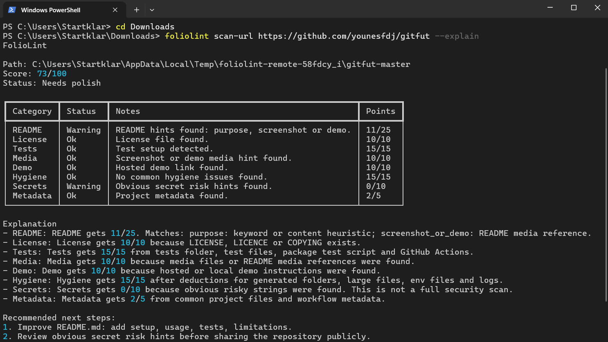

# FolioLint

**English** | [Deutsch](README_DE.md)

FolioLint checks what readers can find when they open a repository: a README, setup instructions, a licence, tests and demo material. It also flags common hygiene issues and obvious secret patterns. Local scans work offline.



## Installation

From the FolioLint checkout, use Python 3.11 or later in a virtual environment.

```sh
python -m venv .venv
```

Activate with `source .venv/bin/activate` on macOS or Linux, or `.\.venv\Scripts\Activate.ps1` in PowerShell. Run `python -m pip install .`. On Windows you can also use `.\.venv\Scripts\python -m pip install .` and call `.\.venv\Scripts\foliolint` directly.

## Usage

```sh
foliolint scan . --explain
foliolint scan ../SortLab --format json --output report.json
foliolint scan-url https://github.com/AleksZyro/FolioLint
```

`scan-url` downloads a temporary ZIP of a public GitHub repository (50 MB download limit by default). Reports support text, JSON, Markdown, HTML and GitHub Actions annotations. `--fail-under` sets a CI threshold.

Example from `foliolint list-checks --format json` (excerpt):

```json
{"id": "readme", "category": "README", "description": "README purpose, setup, usage and limits", "max_points": 25, "scored": true, "ignorable": true, "project_type_max_points": {}}
```

## Configuration and scoring

`foliolint init` creates `.foliolint.toml` in the current directory. Configure ignored paths, check IDs, the large-file threshold or the project type. CLI and library profiles give less weight to media and demos. Ignored checks are excluded from the denominator. `--details` shows evidence and `--no-score` hides the score.

Use `--save-baseline FILE` and `--compare-baseline FILE` to track changes. Baselines record repository provenance when available. Mismatched identities prevent comparison. Legacy baselines without provenance are marked unverified.

The rules measure presentation signals. Assessing code quality and investigating possible secrets require separate review.

[Scoring](docs/scoring.md) · [Config examples](docs/examples) · [Limits](docs/limitations.md) · [Warnings](docs/warnings.md)

## Development

```sh
python -m pip install -e ".[dev]"
pytest -q
ruff check .
ruff format --check .
```

[MIT](LICENSE) · [Portfolio](https://aleksandar-nikolic.ch/)
