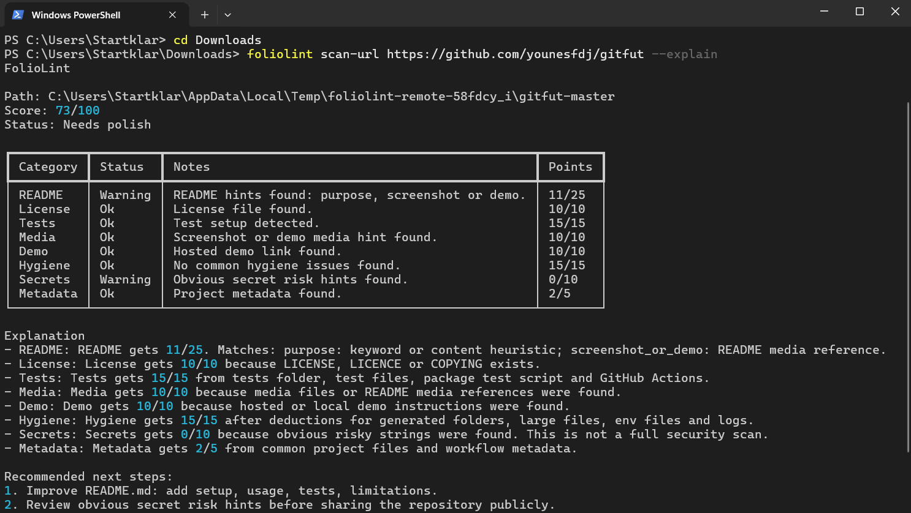

# FolioLint

[English](README.md) | **Deutsch**

FolioLint prüft, was Leserinnen und Leser in einem Repository finden: README, Installation, Lizenz, Tests und Demomaterial. Es meldet ausserdem auffällige Dateien und einfache Secret-Muster. Lokale Scans laufen offline.



## Installation

Verwende im geklonten FolioLint-Verzeichnis Python ab 3.11 in einer virtuellen Umgebung.

```sh
python -m venv .venv
```

Aktiviere die Umgebung mit `source .venv/bin/activate` unter macOS oder Linux oder mit `.\.venv\Scripts\Activate.ps1` in PowerShell. Installiere das Paket mit `python -m pip install .`. Unter Windows kannst du auch `.\.venv\Scripts\python -m pip install .` verwenden und `.\.venv\Scripts\foliolint` direkt aufrufen.

## Verwendung

```sh
foliolint scan . --explain
foliolint scan ../SortLab --format json --output report.json
foliolint scan-url https://github.com/AleksZyro/FolioLint
```

`scan-url` lädt ein öffentliches GitHub-Repository als temporäres ZIP herunter (standardmässig höchstens 50 MB Download). Berichte gibt es als Text, JSON, Markdown, HTML oder GitHub-Actions-Annotationen. Mit `--fail-under` setzt du eine Schwelle für CI.

Ausschnitt aus `foliolint list-checks --format json`:

```json
{"id": "readme", "category": "README", "description": "README purpose, setup, usage and limits", "max_points": 25, "scored": true, "ignorable": true, "project_type_max_points": {}}
```

## Konfiguration und Bewertung

`foliolint init` erstellt `.foliolint.toml` im aktuellen Verzeichnis. Dort lassen sich Pfade und Checks ausschliessen sowie Dateigrössenschwelle und Projekttyp festlegen. Bei CLIs und Bibliotheken zählen Medien und Demos weniger. Ausgeschlossene Checks entfallen aus der Bezugsgrösse. `--details` zeigt die Belege, `--no-score` blendet die Punktzahl aus.

Mit `--save-baseline DATEI` und `--compare-baseline DATEI` verfolgst du Änderungen. Baselines enthalten, soweit verfügbar, die Herkunft des Repositories. Unterschiedliche Identitäten verhindern den Vergleich. Ältere Baselines ohne Herkunft gelten als ungeprüft.

Die Regeln bewerten Hinweise auf die öffentliche Präsentation. Codequalität und mögliche Zugangsdaten erfordern eine separate Prüfung.

[Scoring](docs/scoring.md) · [Config examples](docs/examples) · [Limits](docs/limitations.md) · [Warnings](docs/warnings.md)

## Entwicklung

```sh
python -m pip install -e ".[dev]"
pytest -q
ruff check .
ruff format --check .
```

[MIT](LICENSE) · [Portfolio](https://aleksandar-nikolic.ch/)
